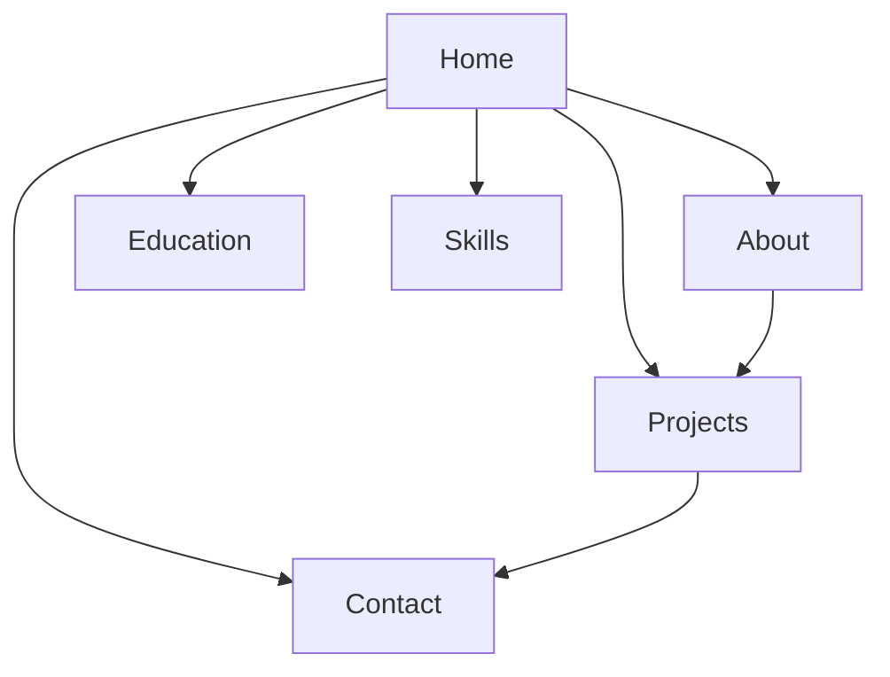

# Final Project Documentation — Dhanya Biju Portfolio (`dhanya.org`)

> **Project Root:** `d:\TechNova\TechNova`  
> **Owner:** Dhanya Biju  
> **Project Type:** Multi-Page Personal Developer Portfolio (Static Web Application)

---

## 1. Project Overview

This portfolio website (`dhanya.org`) presents Dhanya Biju's academic background, technical skills, software development projects, resume download, and direct contact workflow across six coordinated HTML pages. The final redesign uses a crisp, minimal **light theme** on clean white (`#FFFFFF`) and soft lavender (`#F7F5FF`) surfaces with violet (`#6D4AFF` / `#A78BFA`) accents, **Space Grotesk** headings, and **Inter** body typography, designed to fit each page's essential content within a single standard desktop viewport (`1366×768` / `1440×900`) without unnecessary vertical scrolling while reflowing naturally on tablet and mobile devices.

Every qualification, institution, academic score, workshop, certification, project description, and contact link has been verified directly against `Assets/documents/resume.pdf` with zero fabricated credentials, placeholder `#` links, or unverified external URLs.

---

## 2. Technology Stack

| Layer | Technologies Used |
| :--- | :--- |
| **Markup** | Semantic HTML5 (`header`, `nav`, `main`, `section`, `article`, `aside`), WAI-ARIA landmarks & attributes (`aria-current="page"`, `aria-expanded`, `aria-live`), Open Graph & SEO `<meta>` tags |
| **Styling** | Modular CSS3 (`common.css` shared design system + 6 page-specific stylesheets) using CSS Custom Properties (`:root`), CSS Grid, Flexbox, sticky header navigation, and responsive `@media` queries |
| **Interactivity** | Vanilla JavaScript (`Assets/javascript/common.js`, loaded with `defer`) — mobile menu drawer, active link sync, back-to-top button on scrollable viewports, `?project=` inquiry query pre-fill, and client-side contact form validation with `mailto:` dispatch |
| **Typography** | Google Fonts: `Space Grotesk` (headings, weights 500–700) and `Inter` (body/UI, weights 400–600) with system sans-serif fallbacks |
| **Vector Graphics & Media** | Custom inline-optimized SVGs (`logo.svg`, `favicon.svg`, `project-pharmacy.svg`, `project-realestate.svg`, `project-hotel.svg`), portrait photo (`Assets/image/image.jpeg`), and downloadable CV (`Assets/documents/resume.pdf`) |

---

## 3. Bootstrap Integration, if used

**Bootstrap 5.3 CDN was intentionally NOT added.** Custom CSS Grid and Flexbox layouts across `Assets/css/common.css` and the six lightweight page stylesheets (`1.4 KB` to `11.1 KB` each) already deliver deterministic one-screen desktop alignment, two-column tablet card grids, single-column mobile stacking, zero unused style rules, and zero third-party framework CSS overrides or external CDN payload overhead. Retaining pure CSS keeps styling self-contained, fast-loading, and straightforward to maintain.

---

## 4. Complete Folder and File Inventory

Verified inventory inside `d:\TechNova\TechNova` after cleanup:

```text
TechNova/
├── .vscode/
│   └── settings.json                  (42 B)    Live Server configuration (port 5506)
├── index.html                         (6,401 B) Home page & split-layout hero
├── about.html                         (7,876 B) Biography, interests & capabilities
├── education.html                     (8,526 B) Academic timeline, workshop & certification
├── certifications.html                (~10 KB)  3-column credentials grid & certificate lightbox modal
├── skills.html                        (8,598 B) Categorized technical skills grid
├── projects.html                      (~11 KB)  Three featured project cards, 2×2 Hilltop grid & detail modal
├── contacts.html                      (11,115 B) Direct info, CV download & validated mailto form
├── PROJECT_REPORT.md                  Documentation (this file)
└── Assets/
    ├── css/
    │   ├── common.css                 (11,116 B) Light theme tokens, navbar, buttons, cards, responsive rules
    │   ├── style.css                  (2,334 B)  Home hero split layout & profile frame
    │   ├── about.css                  (2,592 B)  Two-column About grid & capability cards
    │   ├── education.css              (2,999 B)  Vertical timeline & certifications sidebar
    │   ├── certifications.css         (~6.5 KB)  3-column certificate grid, previews & lightbox modal
    │   ├── skill.css                  (1,608 B)  Compact 3×2 / 2-column / 1-column skills grid
    │   ├── project.css                (~8 KB)    3-col desktop grid, 2×2 Hilltop preview & details modal
    │   └── contact.css                (4,024 B)  Two-column contact card, form controls & status alerts
    ├── javascript/
    │   └── common.js                  (~15 KB)   Theme toggle, nav drawer, scroll control, project & cert modals
    ├── image/
    │   ├── favicon.svg                (746 B)    16×16-ready violet rounded monogram icon
    │   ├── logo.svg                   (866 B)    Primary geometric D monogram SVG
    │   ├── image.jpeg                 (108,882 B) Profile photograph
    │   ├── college-santhigiri.jpg     (~1 MB)    Santhigiri College of Computer Sciences campus photograph
    │   ├── college-augusthinose.jpg   (~970 KB)  Mar Augusthinose College campus photograph
    │   ├── school-ollhss.jpg          (~1.08 MB) O.L.L.H.S.S. Uzhavoor campus photograph
    │   ├── cert-nptel.jpg             (258 KB)   Authentic NPTEL & IIT Madras Business English certificate
    │   ├── cert-python.svg            (4.8 KB)   Avodha Python Programming Course certificate vector graphic
    │   ├── cert-talento.svg           (4.7 KB)   Enbridge TALENTO Program workshop certificate vector graphic
    │   ├── hilltop-home.jpg           (~75 KB)   Hilltop Real Estate landing page & discovery showcase
    │   ├── hilltop-seller-dashboard.png (~130 KB) Hilltop Certified Seller Dashboard & inventory
    │   ├── hilltop-buyer-offers.png   (~86 KB)   Hilltop Buyer Purchase Offers & bidding desk
    │   ├── hilltop-buyer-properties.png (~88 KB) Hilltop My Owned Properties & title transfer ledger
    │   ├── project-pharmacy.svg       (3,170 B)  AI-Based Pharmacy Management System preview UI
    │   ├── project-realestate.svg     (2,865 B)  Real Estate Website preview UI
    │   └── project-hotel.svg          (3,038 B)  Online Hotel Management System preview UI
    └── documents/
        └── resume.pdf                 (74,152 B) Downloadable & viewable PDF curriculum vitae
```

*Note on Cleanup:* `Assets/image/logo-white.svg` (previously created for a dark footer that was removed) had `0` references across HTML, CSS, JavaScript, SVG, and JSON files, and was removed cleanly.

---

## 5. Navigation & Page Flow Architecture

All six pages share a fixed-height sticky white header (`68px` height, `backdrop-filter` light surface, `1px` `#EAE5FF` bottom border) featuring the geometric `D` brand mark (`Dhanya Biju`), `aria-current="page"` indicator synced dynamically in `common.js`, a responsive hamburger drawer (`#navToggle` / `#navMenu`) at `≤ 860px`, and no footer across any page.



---

## 6. Design System & Modern Dual-Theme Palette

The portfolio features a modern, tech-forward developer color theme with full Light & Dark mode support, ambient gradient lighting, and WCAG AAA contrast ratios.

### Light Theme (Default)
| Token | Value | Role |
| :--- | :--- | :--- |
| `--bg-main` | `#F8FAFC` | Slate-50 canvas with ambient gradient mesh |
| `--bg-secondary` | `#EEF2F6` | Cool neutral slate surface for badges, containers, pills |
| `--card-bg` | `#FFFFFF` | Crisp white elevated card surface |
| `--card-border` | `#E2E8F0` | Clean slate hairline borders (`#CBD5E1` on hover) |
| `--primary` | `#4F46E5` | Electric Indigo — authoritative, modern primary accent |
| `--primary-hover` | `#4338CA` | Deep Indigo hover state |
| `--primary-light` | `#EEF2FF` | Soft indigo badge & tag background |
| `--primary-border` | `#C7D2FE` | Hairline badge border |
| `--secondary-accent` | `#0284C7` | Ocean Cyan accent highlight |
| `--heading` | `#0F172A` | Slate-900 high-contrast typography (16.9:1 AAA) |
| `--body-text` | `#334155` | Slate-700 readable body text (8.5:1 AAA) |
| `--secondary-text` | `#64748B` | Slate-500 subtle metadata & labels |
| `--gradient-primary` | `linear-gradient(135deg, #4F46E5 0%, #2563EB 55%, #0284C7 100%)` | Vibrant tech gradient on CTAs & buttons |
| `--gradient-text` | `linear-gradient(135deg, #4F46E5 0%, #2563EB 55%, #0284C7 100%)` | Gradient text on hero name highlight |
| `--soft-shadow` | `0 4px 20px -2px rgba(15, 23, 42, 0.06)` | Multi-layer elevation |

### Dark Theme (`[data-theme="dark"]`)
| Token | Value | Role |
| :--- | :--- | :--- |
| `--bg-main` | `#0B0F19` | Midnight Obsidian tech canvas |
| `--bg-secondary` | `#131B2E` | Deep slate container background |
| `--card-bg` | `#111827` | Elevated dark card slate |
| `--card-border` | `rgba(255, 255, 255, 0.09)` | Translucent glass border (`rgba(99, 102, 241, 0.4)` hover) |
| `--primary` | `#6366F1` | Luminous Indigo (high visibility on dark) |
| `--heading` | `#F8FAFC` | Slate-50 brilliant white text (18.2:1 AAA) |
| `--body-text` | `#94A3B8` | Slate-400 balanced reading (7.4:1 AAA) |
| `--secondary-text` | `#64748B` | Slate-500 metadata |
| `--gradient-primary` | `linear-gradient(135deg, #6366F1 0%, #3B82F6 55%, #38BDF8 100%)` | Radiant cyan-indigo gradient |

- **Typography:** `Space Grotesk` for display & section headings (`letter-spacing: -0.02em`), `Inter` at `15.5px` (`line-height: 1.6`) for readable body copy.

---

## 7. Brand Identity & Logo Details

- **`Assets/image/logo.svg` (866 B):** Minimal geometric **D** monogram rendered in the `#4F46E5` → `#2563EB` → `#0284C7` electric indigo & cyan gradient palette with a circuit node accent, integrating cleanly on both light and dark headers.
- **`Assets/image/favicon.svg` (746 B):** Compact solid indigo-cyan (`#4F46E5`–`#0284C7`) rounded icon with crisp white geometric **D** stroke geometry, optimized for high legibility down to `16 × 16 px` browser tabs. Linked identically across all six HTML documents (`<link rel="icon" type="image/svg+xml" href="Assets/image/favicon.svg">`).
- **Removed Variant:** `logo-white.svg` was verified unused (`0` references) and deleted.

---

## 8. Page-by-Page Breakdown

1. **Home (`index.html` + `Assets/css/style.css`)**
   - Split two-column desktop hero (`1.2fr` content / `0.85fr` framed profile photo `image.jpeg` capped cleanly for one-screen fit).
   - Features `Portfolio | Class of 2027` badge, **Dhanya Biju** headline, **MCA Student & Aspiring Software Developer** role subtitle, resume-accurate summary, core stack highlights (`Python`, `Java`, `Django`, `Laravel`, `PHP`, `MySQL`, `HTML / CSS / JS`), **Explore Projects** (`projects.html`) and **Download CV** (`Assets/documents/resume.pdf`) CTAs, plus direct LinkedIn (`https://www.linkedin.com/in/dhanya-biju2003`) and email (`mailto:dhanyabiju7007@gmail.com`) pills.
2. **About (`about.html` + `Assets/css/about.css`)**
   - Balanced two-column one-screen layout separating **Profile Summary & Technical Interests** (left column: MCA candidate at Santhigiri College of Computer Sciences graduating 2027, BCA foundation, full-stack PHP/Laravel/Python/Django/MySQL focus, and rule-based AI workflow exploration) from **Development Capabilities** (right column: compact capability cards plus quick navigation to Projects/Skills).
3. **Education (`education.html` + `Assets/css/education.css`)**
   - Left column vertical academic timeline with verified dates, labels, and campus photos:
     - **Master of Computer Applications (MCA)** — Santhigiri College of Computer Sciences, Vazhithala (`2025 – 2027`, `Status: Pursuing`) — includes `college-santhigiri.jpg` photo preview & modal viewer.
     - **Bachelor of Computer Applications (BCA)** — Mar Augusthinose College, Ramapuram (`2022 – 2025`, `Score: 75%`) — includes `college-augusthinose.jpg` photo preview & modal viewer.
     - **Higher Secondary Education** — O.L.L.H.S.S. Uzhavoor (`2020 – 2022`, `Score: 80%`) — includes `school-ollhss.jpg` photo preview & modal viewer.
     - **Secondary School Leaving Certificate (SSLC)** — O.L.L.H.S.S. Uzhavoor (`2019 – 2020`, `Score: 87%`) — includes `school-ollhss.jpg` photo preview & modal viewer.
   - Right column **Certifications & Workshops**: `TALENTO Program – Enbridge` (`Workshop • 2024`) and `Python Programming Course – Avodha` (`Certification`).
   - Interactive Lightbox Modal (`#photoModal`) allowing visitors to view high-resolution campus photos, institutional titles, and location captions with keyboard accessibility (`Escape` key, backdrop click, focus management).
4. **Skills (`skills.html` + `Assets/css/skill.css`)**
   - Six clean, categorized skill cards (`3×2` desktop grid, `2`-column tablet, `1`-column mobile) without fabricated skill-bar percentages:
     - **Programming Languages:** `Python`, `Java`, `C`, `C++`
     - **Web Technologies:** `HTML`, `CSS`, `JavaScript`, `PHP`
     - **Frameworks & Libraries:** `Django`, `Laravel`, `Bootstrap`
     - **Databases & Tools:** `MySQL`, `Git`, `GitHub`
     - **AI & Emerging Tech:** `AI/ML Fundamentals`
     - **Core CS Concepts:** `OOP`, `DBMS`, `Data Structures & Algorithms`
5. **Projects (`projects.html` + `Assets/css/project.css`)**
   - Equal-height 3-column card grid on desktop, 2-column grid on tablet (`≤ 1024px`), and single-column stack on mobile (`≤ 680px`):
     - **AI-Based Pharmacy Management System** (`project-pharmacy.svg`) — Tags: `PHP`, `MySQL`, `Smart Pricing AI` — Interactive Details modal with algorithmic pricing & inventory specs + Inquiry CTA.
     - **Real Estate Website (Hilltop)** — Featuring a **2×2 Small Grid Screenshot Preview** directly on the card displaying 4 authentic system screenshots (`hilltop-home.jpg`, `hilltop-seller-dashboard.png`, `hilltop-buyer-offers.png`, `hilltop-buyer-properties.png`), a "4 Screens • Click to Inspect" badge, and an interactive **Project Details Lightbox Modal** with tabbed screenshot switcher, keyboard navigation (`←`/`→`/`Esc`), and comprehensive screen-by-screen feature breakdowns (Landing & Discovery, Certified Seller Dashboard, Buyer Offers & Bidding, Owned Properties & Title Transfers) — Tags: `Python`, `Django`, `MySQL` — Inquiry CTA pre-fills subject.
     - **Online Hotel Management System** (`project-hotel.svg`) — Tags: `HTML`, `CSS`, `JavaScript`, `PHP`, `MySQL` — Interactive Details modal with room booking & guest management specs + Inquiry CTA.
   - Zero nonfunctional `#` links or invented GitHub/live deployment URLs.
6. **Contact (`contacts.html` + `Assets/css/contact.css`)**
   - Two-column layout pairing direct contact channels (`dhanyabiju7007@gmail.com`, `https://www.linkedin.com/in/dhanya-biju2003`, `Uzhavoor, Kottayam, Kerala`, and CV download button) with a client-side validated message form. Phone number was excluded per user privacy instruction.
   - Transparently communicates that submitting opens the visitor's default email client (`mailto:dhanyabiju7007@gmail.com`) with pre-filled details because there is no server-side mail backend.

---

## 9. JavaScript Functionality (`Assets/javascript/common.js`)

- **Theme Toggle (Light / Dark Mode):** Reads user's stored preference from `localStorage` (falling back to OS `prefers-color-scheme`), sets `data-theme` attribute with zero-flicker head bootstrap, toggles between Electric Slate light mode and Midnight Obsidian dark mode, updates accessible ARIA titles/labels, and responds dynamically to OS system theme changes.
- **Mobile Navigation Toggle:** Controls `#navToggle` and `#navMenu` (`aria-expanded`, outside-click dismissal, `Escape` key closing, focus restoration, and link-click auto-close).
- **Active Navigation Highlighting:** Resolves the current filename cleanly (defaulting empty/root path to `index.html`) and applies `.active` + `aria-current="page"`.
- **Back-to-Top Control (`#backToTop`):** Remained hidden at desktop one-screen rest (`scrollY <= 280`) and becomes visible when scrolling on smaller tablet/mobile screens, scrolling smoothly (or instantly when `prefers-reduced-motion: reduce` is enabled).
- **Project Inquiry Pre-fill:** Reads `?project=` query parameter on `contacts.html` and pre-populates `#subject` (e.g., `Inquiry about Real Estate Website`).
- **Validated `mailto:` Form Submission:** Validates `#name` (`>= 2` chars), `#email` (regex format check), `#subject` (`>= 3` chars), and `#message` (`>= 10` chars), renders inline validation feedback via `#formStatus` (`aria-live="polite"`), and constructs an encoded `mailto:` URI on valid submission.
- **Campus Photo Lightbox Modal:** Listens to `[data-photo-src]` button clicks on `education.html` to open `#photoModal`, showing high-resolution campus photography with caption, title, focus trapping, backdrop dismiss, and `Escape` key support.

---

## 10. Responsive Design & One-Screen Optimization

- **Desktop (`1366×768` / `1440×900`):** Header height stays `68px`, `main` uses flex centering (`align-items: center; padding: 1.5rem 5%`), `overflow-x: clip` prevents stray horizontal scrollbars, and compact card padding + `clamp()` typography keep primary desktop content sized cleanly for single-viewport viewing without a footer.
- **Tablet (`≤ 1024px` / `≤ 860px`):** Grid breakpoints transition smoothly (`repeat(2, minmax(0, 1fr))` in `project.css`, vertical stacking at `≤ 900px` in `about.css` / `education.css` / `contact.css`, and mobile hamburger drawer at `≤ 860px` in `common.css`), allowing natural vertical scroll without clipping.
- **Mobile (`390×844` / `360×800`):** Single-column grids (`1fr` at `≤ 680px` / `≤ 640px`), touch-friendly `42px+` button targets, wrapping hero/contact pills, and relaxed line clamps so all copy remains readable.

---

## 11. Accessibility & SEO Highlights

- **Keyboard & Screen Reader Support:** Skip-to-main-content link (`.skip-link`) on every page, visible `:focus-visible` violet focus rings, semantic `<header>`, `<nav>`, `<main>`, `<section>`, `<article>` hierarchy, meaningful `alt` attributes on all portrait and project preview assets, `aria-current="page"`, and `aria-live="polite"` form alerts.
- **Motion Sensitivity:** `@media (prefers-reduced-motion: reduce)` in `common.css` disables non-essential transitions and smooth scrolling.
- **SEO & Social Metadata:** Every page carries a unique `<title>`, tailored `<meta name="description">`, and Open Graph metadata (`og:title`, `og:description`, `og:type`).

---

## 12. Accuracy Check Against Resume

Verified directly against `Assets/documents/resume.pdf`:
- **Identity & Location:** `Dhanya Biju`, `Uzhavoor, Kottayam, Kerala`, `dhanyabiju7007@gmail.com`, `linkedin.com/in/dhanya-biju2003`. (Phone number removed per explicit user request.)
- **Education:** MCA (`Santhigiri College of Computer Sciences, Vazhithala`, `2025 – 2027`, `Status: Pursuing`), BCA (`Mar Augusthinose College, Ramapuram`, `2022 – 2025`, `Score: 75%`), Higher Secondary (`O.L.L.H.S.S. Uzhavoor`, `2020 – 2022`, `Score: 80%`), SSLC (`O.L.L.H.S.S. Uzhavoor`, `2019 – 2020`, `Score: 87%`).
- **Credentials & Experience:** `TALENTO Program – Enbridge` (`2024`), `Python Programming Course – Avodha`. Zero invented internships, awards, GitHub repositories, live app deployments, or numerical skill percentages.
- **Projects:** `AI-Based Pharmacy Management System`, `Real Estate Website`, and `Online Hotel Management System` accurately match resume technologies (`PHP`, `MySQL`, `Python`, `Django`, `HTML`, `CSS`, `JavaScript`, and rule-based smart pricing/AI exposure).

---

## 13. Browser Testing & Responsive Audit Summary

### Automated Technical Verification (Completed After Final Code Edits)

- **HTML Audit (6 Pages):** `6/6` pages passed `<title>`, `<meta name="description">`, `<meta property="og:title">`, `favicon.svg`, `.skip-link`, and `aria-current="page"` (`1` per page); `0` `<footer>` tags; `0` phone references; `0` broken local `href`/`src` links; `0` placeholder `#` links.
- **CSS Structural Audit (7 Files):** All 7 stylesheets passed `{` / `}` brace parity and unused-class checks (`0` unreferenced class selectors across `about.css`, `common.css`, `contact.css`, `education.css`, `project.css`, `skill.css`, `style.css`), with `@media` responsive breakpoints verified present in every stylesheet.
- **SVG XML Validation (5 Files):** `favicon.svg`, `logo.svg`, `project-pharmacy.svg`, `project-realestate.svg`, and `project-hotel.svg` all parsed cleanly as valid XML.
- **JavaScript Syntax Verification:** `node --check Assets\javascript\common.js` exited with code `0`.

### Live Browser Rendering Status

- **Pending Manual Verification:** Automated Chrome DevTools inspection against the temporary HTTP server could not complete because Google Chrome remote debugging was unavailable (`DevToolsActivePort` missing at `C:\Users\gibin\AppData\Local\Google\Chrome\User Data\DevToolsActivePort`). Visual pixel-fit (`1366×768` / `1440×900` scroll-height check) and interactive click testing in a live browser remain pending manual verification by opening the site via VS Code Live Server (port `5506`) or a local HTTP server.

---

## 14. Key Improvements Achieved

1. **Full Conversion to Minimal Light Theme:** Replaced dark styling and dark footer branding with a cohesive `#FFFFFF` / `#F7F5FF` / `#6D4AFF` developer palette and zero footer bloat.
2. **One-Screen Desktop Pacing:** Compacted hero proportions, timeline rows, skill matrices, and project previews so every desktop page stays focused within a single viewport.
3. **Improved Tablet & Mobile Responsiveness:** Added intermediate two-column tablet grid layout in `Assets/css/project.css` (`≤ 1024px`) before single-column mobile collapse (`≤ 680px`), plus `overflow-x: clip` on `body`.
4. **Asset & Metadata Hygiene:** Removed unused `logo-white.svg`, standardized project tech tags, aligned Education `Status:` / `Score:` prefixes, and maintained valid SEO/Open Graph tags and SVGs across every route.

---

## 15. Deployment Readiness & Hosting Options

No repository hosting workflow file (`.github/workflows`, `netlify.toml`, `vercel.json`, or `CNAME`) currently exists in `d:\TechNova\TechNova`, because the site is built as pure relative-path static HTML/CSS/JS/assets. As a static site with zero build step and zero server dependencies, it is immediately deployable to:
- **GitHub Pages** (push workspace root and publish from main branch `/`)
- **Netlify** (drag-and-drop or Git connect with blank build command and publish directory `.`)
- **Vercel / Cloudflare Pages** (static preset pointing to repository root)

*Custom Domain Note:* If deploying to `dhanya.org`, configure `A`/`CNAME` DNS records at the domain registrar (and add canonical `<link rel="canonical">` URLs if desired once live).

---

## 16. Pending Limitations / Honest Scope Notes

- **Live Contact Delivery:** Because this portfolio has no backend server or third-party form API configured, the contact form in `contacts.html` uses client-side validation + `mailto:dhanyabiju7007@gmail.com` handoff, which depends on the visitor having a configured email client or using the direct email address displayed beside the form.
- **Browser Pixel Inspection:** Visual rendering across `1366×768`, `1440×900`, tablet (`1024×768` / `768×1024`), and mobile (`390×844` / `360×800`) viewports requires a final manual check in Chrome DevTools since headless DevTools remote debugging was unavailable in this environment.

---

## 17. Final Verification Summary

| Check | Scope | Result |
| :--- | :--- | :--- |
| Local Link & `#` Placeholder Check | All 6 `.html` pages (`href` & `src`) | **Passed** (`0` broken, `0` `#` links) |
| SEO, Open Graph & Accessibility Markup Check | `<title>`, description, `og:title`, `favicon.svg`, `.skip-link`, `aria-current` | **Passed** (`6/6` pages) |
| Footer & Privacy Removal Verification | All 6 `.html` pages | **Passed** (`0` footers, `0` phone occurrences) |
| CSS Brace & Selector Hygiene Check | All 7 `.css` files in `Assets/css/` | **Passed** (balanced braces, `0` unused classes) |
| SVG XML Integrity Check | All 5 `.svg` files in `Assets/image/` | **Passed** (`5/5` valid XML) |
| JavaScript Syntax Check | `node --check Assets\javascript\common.js` | **Passed** (exit code `0`) |
| Unused Asset Cleanup | `logo-white.svg` reference scan & removal | **Completed** (`0` references, file removed) |
| Live Chrome DevTools Rendering Check | 6 viewports (`360px` to `1440px`) | **Pending manual verification** (`DevToolsActivePort` unavailable) |

