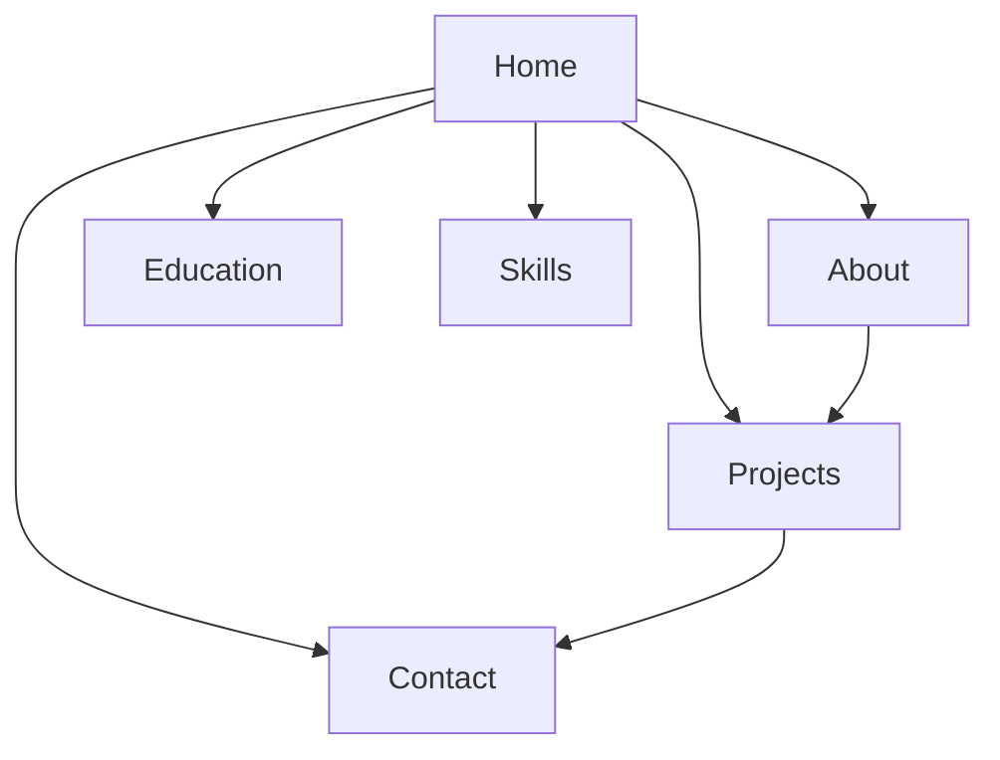

# Final Project Documentation — Dhanya Biju Portfolio (`dhanya.org`)

> **Project Root:** `d:\TechNova\TechNova`  
> **Owner:** Dhanya Biju  
> **Project Type:** Multi-Page Personal Developer Portfolio (Static Web Application)

---

## 1. Project Overview

This portfolio website (`dhanya.org`) presents Dhanya Biju's academic background, technical skills, software development projects, resume download, and direct contact workflow across six coordinated HTML pages. The final redesign uses a crisp, minimal **light theme** on clean white (`#FFFFFF`) and soft lavender (`#F7F5FF`) surfaces with violet (`#6D4AFF` / `#A78BFA`) accents, **Space Grotesk** headings, and **Inter** body typography, designed to fit each page's essential content within a single standard desktop viewport (`1366×768` / `1440×900`) without unnecessary vertical scrolling while reflowing naturally on tablet and mobile devices.

Every qualification, institution, academic score, workshop, certification, project description, and contact link has been verified directly against `Assets/documents/resume.pdf` with zero fabricated credentials, placeholder `#` links, or unverified external URLs.

---

## 2. Technology Stack

| Layer | Technologies Used |
| :--- | :--- |
| **Markup** | Semantic HTML5 (`header`, `nav`, `main`, `section`, `article`, `aside`), WAI-ARIA landmarks & attributes (`aria-current="page"`, `aria-expanded`, `aria-live`), Open Graph & SEO `<meta>` tags |
| **Styling** | Modular CSS3 (`common.css` shared design system + 6 page-specific stylesheets) using CSS Custom Properties (`:root`), CSS Grid, Flexbox, sticky header navigation, and responsive `@media` queries |
| **Interactivity** | Vanilla JavaScript (`Assets/javascript/common.js`, loaded with `defer`) — mobile menu drawer, active link sync, back-to-top button on scrollable viewports, `?project=` inquiry query pre-fill, and client-side contact form validation with `mailto:` dispatch |
| **Typography** | Google Fonts: `Space Grotesk` (headings, weights 500–700) and `Inter` (body/UI, weights 400–600) with system sans-serif fallbacks |
| **Vector Graphics & Media** | Custom inline-optimized SVGs (`logo.svg`, `favicon.svg`, `project-pharmacy.svg`, `project-realestate.svg`, `project-hotel.svg`), portrait photo (`Assets/image/image.jpeg`), and downloadable CV (`Assets/documents/resume.pdf`) |

---

## 3. Bootstrap Integration, if used

**Bootstrap 5.3 CDN was intentionally NOT added.** Custom CSS Grid and Flexbox layouts across `Assets/css/common.css` and the six lightweight page stylesheets (`1.4 KB` to `11.1 KB` each) already deliver deterministic one-screen desktop alignment, two-column tablet card grids, single-column mobile stacking, zero unused style rules, and zero third-party framework CSS overrides or external CDN payload overhead. Retaining pure CSS keeps styling self-contained, fast-loading, and straightforward to maintain.

---

## 4. Complete Folder and File Inventory

Verified inventory inside `d:\TechNova\TechNova` after cleanup:

```text
TechNova/
├── .vscode/
│   └── settings.json                  (42 B)    Live Server configuration (port 5506)
├── index.html                         (6,401 B) Home page & split-layout hero
├── about.html                         (7,876 B) Biography, interests & capabilities
├── education.html                     (8,526 B) Academic timeline, workshop & certification
├── certifications.html                (~10 KB)  3-column credentials grid & certificate lightbox modal
├── skills.html                        (8,598 B) Categorized technical skills grid
├── projects.html                      (~11 KB)  Three featured project cards, 2×2 Hilltop grid & detail modal
├── contacts.html                      (11,115 B) Direct info, CV download & validated mailto form
├── PROJECT_REPORT.md                  Documentation (this file)
└── Assets/
    ├── css/
    │   ├── common.css                 (11,116 B) Light theme tokens, navbar, buttons, cards, responsive rules
    │   ├── style.css                  (2,334 B)  Home hero split layout & profile frame
    │   ├── about.css                  (~15 KB)   Dark Neon Glassmorphism theme, profile glow ring, interests, 12 tech tiles & CTA
    │   ├── education.css              (2,999 B)  Vertical timeline & certifications sidebar
    │   ├── certifications.css         (~6.5 KB)  3-column certificate grid, previews & lightbox modal
    │   ├── skill.css                  (1,608 B)  Compact 3×2 / 2-column / 1-column skills grid
    │   ├── project.css                (~14 KB)   Dark Neon Glassmorphism theme, 2×2 screenshot grids & interactive modal lightbox
    │   └── contact.css                (~10 KB)   Dark Neon Glassmorphism theme, gradient icon boxes, validated form & social connect
    ├── javascript/
    │   └── common.js                  (~18 KB)   Theme toggle, nav drawer, scroll control, project modal lightbox & cert viewer
    ├── image/
    │   ├── favicon.svg                (746 B)    16×16-ready violet rounded monogram icon
    │   ├── logo.svg                   (866 B)    Primary geometric D monogram SVG
    │   ├── image.jpeg                 (108,882 B) Profile photograph
    │   ├── college-santhigiri.jpg     (~226 KB)  Santhigiri College of Computer Sciences campus photograph
    │   ├── college-augusthinose.jpg   (~328 KB)  Mar Augusthinose College (MAC), Ramapuram campus photograph
    │   ├── high school-ollhss.jpg     (~318 KB)  Our Lady of Lourdes H.S.S. Uzhavoor campus photograph
    │   ├── school-ollhss.jpg          (~275 KB)  Our Lady of Lourdes H.S.S. Uzhavoor school building photograph
    │   ├── cert-nptel.jpg             (258 KB)   Authentic NPTEL & IIT Madras Business English certificate
    │   ├── cert-python.svg            (4.8 KB)   Avodha Python Programming Course certificate vector graphic
    │   ├── cert-talento.svg           (4.7 KB)   Enbridge TALENTO Program workshop certificate vector graphic
    │   ├── hilltop-home.jpg           (~75 KB)   Hilltop Real Estate landing page & discovery showcase
    │   ├── hilltop-seller-dashboard.png (~130 KB) Hilltop Certified Seller Dashboard & inventory
    │   ├── hilltop-buyer-offers.png   (~86 KB)   Hilltop Buyer Purchase Offers & bidding desk
    │   ├── hilltop-buyer-properties.png (~88 KB) Hilltop My Owned Properties & title transfer ledger
    │   ├── pharmacy-1-landing.jpg     (~94 KB)   AI PharmaCare landing page & B2B SaaS showcase
    │   ├── pharmacy-2-admin.png       (~123 KB)  PharmaAdmin system administrator dashboard & alerts
    │   ├── pharmacy-3-dispensary.jpg  (~80 KB)   PharmaCare dispensary & live prescribing POS cart
    │   ├── pharmacy-4-alert.png       (~123 KB)  Critical low-stock threshold warning & restock modal
    │   ├── pharmacy-5-broadcast.jpg   (~68 KB)   Hospital procurement & supplier bidding broadcast desk
    │   ├── pharmacy-6-quotations.png  (~117 KB)  PharmaSupplier incoming demands & quotation submission
    │   ├── pharmacy-7-supplier-hub.jpg (~73 KB)  PharmaSupplier operations hub & performance metrics
    │   ├── hotel-1-landing.jpg        (~74 KB)   Hotel Paradise luxury resort landing page & discovery portal
    │   ├── hotel-2-admin.png          (~84 KB)   Staff administration & reservation oversight dashboard
    │   ├── hotel-3-booking.jpg        (~58 KB)   Guest suite selection & live availability booking engine
    │   ├── hotel-4-records.jpg        (~54 KB)   Manage your reservations & guest lookup desk
    │   ├── portfolio-home.png         (~71 KB)   Personal Developer Portfolio Website homepage screenshot
    │   ├── project-pharmacy.svg       (3,170 B)  AI-Based Pharmacy Management System preview UI
    │   ├── project-realestate.svg     (2,865 B)  Real Estate Website preview UI
    │   └── project-hotel.svg          (3,038 B)  Online Hotel Management System preview UI
    └── documents/
        └── resume.pdf                 (74,152 B) Downloadable & viewable PDF curriculum vitae
```

*Note on Cleanup:* `Assets/image/logo-white.svg` (previously created for a dark footer that was removed) had `0` references across HTML, CSS, JavaScript, SVG, and JSON files, and was removed cleanly.

---

## 5. Navigation & Page Flow Architecture

All six pages share a fixed-height sticky white header (`68px` height, `backdrop-filter` light surface, `1px` `#EAE5FF` bottom border) featuring the geometric `D` brand mark (`Dhanya Biju`), `aria-current="page"` indicator synced dynamically in `common.js`, a responsive hamburger drawer (`#navToggle` / `#navMenu`) at `≤ 860px`, and no footer across any page.



---

## 6. Design System & Modern Dual-Theme Palette

The portfolio features a modern, tech-forward developer color theme with full Light & Dark mode support, ambient gradient lighting, and WCAG AAA contrast ratios.

### Light Theme (Default)
| Token | Value | Role |
| :--- | :--- | :--- |
| `--bg-main` | `#F8FAFC` | Slate-50 canvas with ambient gradient mesh |
| `--bg-secondary` | `#EEF2F6` | Cool neutral slate surface for badges, containers, pills |
| `--card-bg` | `#FFFFFF` | Crisp white elevated card surface |
| `--card-border` | `#E2E8F0` | Clean slate hairline borders (`#CBD5E1` on hover) |
| `--primary` | `#4F46E5` | Electric Indigo — authoritative, modern primary accent |
| `--primary-hover` | `#4338CA` | Deep Indigo hover state |
| `--primary-light` | `#EEF2FF` | Soft indigo badge & tag background |
| `--primary-border` | `#C7D2FE` | Hairline badge border |
| `--secondary-accent` | `#0284C7` | Ocean Cyan accent highlight |
| `--heading` | `#0F172A` | Slate-900 high-contrast typography (16.9:1 AAA) |
| `--body-text` | `#334155` | Slate-700 readable body text (8.5:1 AAA) |
| `--secondary-text` | `#64748B` | Slate-500 subtle metadata & labels |
| `--gradient-primary` | `linear-gradient(135deg, #4F46E5 0%, #2563EB 55%, #0284C7 100%)` | Vibrant tech gradient on CTAs & buttons |
| `--gradient-text` | `linear-gradient(135deg, #4F46E5 0%, #2563EB 55%, #0284C7 100%)` | Gradient text on hero name highlight |
| `--soft-shadow` | `0 4px 20px -2px rgba(15, 23, 42, 0.06)` | Multi-layer elevation |

### Dark Theme (`[data-theme="dark"]`)
| Token | Value | Role |
| :--- | :--- | :--- |
| `--bg-main` | `#0B0F19` | Midnight Obsidian tech canvas |
| `--bg-secondary` | `#131B2E` | Deep slate container background |
| `--card-bg` | `#111827` | Elevated dark card slate |
| `--card-border` | `rgba(255, 255, 255, 0.09)` | Translucent glass border (`rgba(99, 102, 241, 0.4)` hover) |
| `--primary` | `#6366F1` | Luminous Indigo (high visibility on dark) |
| `--heading` | `#F8FAFC` | Slate-50 brilliant white text (18.2:1 AAA) |
| `--body-text` | `#94A3B8` | Slate-400 balanced reading (7.4:1 AAA) |
| `--secondary-text` | `#64748B` | Slate-500 metadata |
| `--gradient-primary` | `linear-gradient(135deg, #6366F1 0%, #3B82F6 55%, #38BDF8 100%)` | Radiant cyan-indigo gradient |

- **Typography:** `Space Grotesk` for display & section headings (`letter-spacing: -0.02em`), `Inter` at `15.5px` (`line-height: 1.6`) for readable body copy.

---

## 7. Brand Identity & Logo Details

- **`Assets/image/logo.svg` (866 B):** Minimal geometric **D** monogram rendered in the `#4F46E5` → `#2563EB` → `#0284C7` electric indigo & cyan gradient palette with a circuit node accent, integrating cleanly on both light and dark headers.
- **`Assets/image/favicon.svg` (746 B):** Compact solid indigo-cyan (`#4F46E5`–`#0284C7`) rounded icon with crisp white geometric **D** stroke geometry, optimized for high legibility down to `16 × 16 px` browser tabs. Linked identically across all six HTML documents (`<link rel="icon" type="image/svg+xml" href="Assets/image/favicon.svg">`).
- **Removed Variant:** `logo-white.svg` was verified unused (`0` references) and deleted.

---

## 8. Page-by-Page Breakdown

1. **Home (`index.html` + `Assets/css/style.css`)**
   - Split two-column desktop hero (`1.2fr` content / `0.85fr` framed profile photo `image.jpeg` capped cleanly for one-screen fit).
   - Features `Portfolio | Class of 2027` badge, **Dhanya Biju** headline, **MCA Student & Aspiring Software Developer** role subtitle, resume-accurate summary, core stack highlights (`Python`, `Java`, `Django`, `Laravel`, `PHP`, `MySQL`, `HTML / CSS / JS`), **Explore Projects** (`projects.html`) and **Download CV** (`Assets/documents/resume.pdf`) CTAs, plus direct LinkedIn (`https://www.linkedin.com/in/dhanya-biju2003`) and email (`mailto:dhanyabiju7007@gmail.com`) pills.
2. **About (`about.html` + `Assets/css/about.css`)**
   - Reworked in a premium **Dark Neon Glassmorphism** theme (deep navy `#080D1A` canvas, translucent glass cards with `backdrop-filter: blur(16px)`, electric blue `#00D2FF` and purple `#8B5CF6` gradient accents, white typography, and subtle shadows).
   - **Hero Section ("Get to Know Me"):** Subtle entrance animation, subtitle *"A passionate learner exploring technology and building creative solutions."*, personal detail pills (**Dhanya Biju**, **MCA Student | Aspiring Software Developer**, **Location: Kottayam, Kerala**), short professional introduction copy, and a professional rounded profile photo with a glowing blue-purple gradient border and ambient light ring. Top actions include a **Back to Home** button.
   - **About Me:** Direct academic statement detailing MCA studies at Santhigiri College of Computer Sciences, Vazhithala, BCA foundation from Mar Augusthinose College, Ramapuram, development interests in software, web technologies, and database management, and ongoing skills improvement.
   - **Career Goal:** Highlighted goal card with target bullseye icon, quote banner (*"My goal is to build a successful career in the IT industry, strengthen my technical knowledge, improve my programming skills, and develop useful software applications."*), and career focus tags (*IT Industry Growth, Programming Skills, Useful Software*).
   - **Technical Interests:** 4 domain cards with vibrant gradient badges:
     - **Web Development** – Creating responsive, structured, and user-friendly websites with modern web standards.
     - **Software Development** – Learning programming logic, OOP principles, and building practical software applications.
     - **Database Management** – Working with MySQL, relational schemas, SQL queries, and efficient data management.
     - **Artificial Intelligence** – Exploring AI and machine learning concepts, smart algorithms, and intelligent systems.
   - **Technical Knowledge:** 12 authentic vector-branded tech tiles (*Java, Python, PHP, Laravel, Django, HTML, CSS, JavaScript, Bootstrap, MySQL, Git, GitHub*) plus direct CTA button linking to `skills.html`.
   - **Personal Highlights:** 3 strength cards with glowing icons (*Quick Learner, Hardworking, Adaptable*).
   - **Call to Action ("Let's Connect"):** Gradient-accented connect card with 3 action buttons: **View Projects** (`projects.html`), **Contact Me** (`contacts.html`), and **Download Resume** (`Assets/documents/resume.pdf`).
3. **Education (`education.html` + `Assets/css/education.css`)**
   - Redesigned as **🎓 My Educational Journey** with page subtitle, **Back to Home** navigation button, and horizontal milestone tracker (1. SSLC ➔ 2. Higher Secondary ➔ 3. BCA ➔ 4. MCA).
   - Premium vertical animated timeline featuring connecting gradient spine and circular graduation/academic SVG nodes with alternating desktop card layout reflowing cleanly to single column on mobile.
   - Four large, attractive education cards with high-quality rectangular photos (`16:10` aspect ratio), rounded corners, subtle shadows, hover zoom effect (`scale(1.06)`), and photo tag overlays:
     - **Secondary School Leaving Certificate (SSLC)** — St. Thomas HSS, Pala (`85% Percentage`) — includes `school-st-thomas-building.jpg` large preview & lightbox modal.
     - **Higher Secondary Education** — St. Thomas HSS, Pala (`80% Percentage`) — includes `school-st-thomas-campus.jpg` large preview & lightbox modal.
     - **Bachelor of Computer Applications (BCA)** — MAC College, Ramapuram (`75% Percentage`) — includes `college-mac-ramapuram.jpg` large preview & lightbox modal.
     - **Master of Computer Applications (MCA)** — Santhigiri College of Computer Sciences (`75% Percentage`, editable interactive status badge toggling `Pursuing` / `Completed`) — includes `college-santhigiri.jpg` large preview & lightbox modal.
   - Interactive Lightbox Modal (`#photoModal`) allowing visitors to view high-resolution campus and building photos with keyboard accessibility (`Escape` key, backdrop click, focus management).
4. **Skills (`skills.html` + `Assets/css/skill.css`)**
   - Redesigned as **My Technical Skills** with page subtitle, **Back to Home** button, **Download Resume** button (`Assets/documents/resume.pdf`), and a 4-domain metrics overview strip (03 Programming Languages, 04 Web Technologies, 02 Frameworks, 06 Databases & Tools).
   - **Programming Languages:** 3 individual skill cards with official vector brand icons, proficiency level badges, and detailed descriptions:
     - **Java** (`Beginner`): OOP concepts, classes, objects, inheritance, and basic application development.
     - **Python** (`Beginner`): Core syntax, variables, functions, loops, conditions, and programming logic.
     - **PHP** (`Intermediate`): Server-side programming, form handling, session authentication, and dynamic web development.
   - **Web Development Skills:** 4 cards detailing HTML5 (semantic structuring), CSS3 (modern layouts & responsive styling), JavaScript (DOM scripting & events), and Bootstrap (responsive grid & UI components).
   - **Frameworks:** 2 framework cards highlighting Laravel (PHP MVC & Eloquent ORM) and Django (Python MTV & Admin panel).
   - **Database Skills:** Dedicated MySQL feature card detailing database creation, tables, SQL queries, CRUD operations, joins, and management.
   - **Tools & Technologies:** 5-column ecosystem grid featuring Git (version control), GitHub (cloud repositories), VS Code (code editor), XAMPP (local server stack), and Linux (CLI & OS environment).
   - Applied Development CTA card inviting visitors to explore projects and get in touch.
5. **Projects (`projects.html` + `Assets/css/project.css`)**
   - Reworked in a premium **Dark Neon Glassmorphism** theme (deep navy `#060B18` canvas, translucent glass cards with `backdrop-filter: blur(16px)`, electric blue `#00D2FF` and purple `#8B5CF6` glowing borders, neon eyebrow badges, and high-contrast typography).
   - **Page Header:** Small eyebrow heading `SELECTED WORK`, main title `My Projects`, subtitle `"Explore my academic and personal projects, where ideas turn into practical applications."`, and a **Back to Home** button.
   - **Project 1: AI-Based Pharmacy Management System**
     - Description: *"An intelligent pharmacy management platform with medicine inventory management, smart pricing, low-stock alerts, supplier quotations, and medicine procurement."*
     - Technologies: `PHP`, `MySQL`, `Smart Pricing AI`, `B2B Procurement`.
     - Features displayed on card & modal: `Admin Dashboard`, `Pharmacist Dashboard`, `Supplier Management`, `Medicine Inventory`, `Smart Pricing`, `Stock Alerts`, `Supplier Price Comparison`, `Purchase Management`.
     - **2×2 Small Grid Screenshot Preview:** `pharmacy-1-landing.jpg`, `pharmacy-2-admin.png`, `pharmacy-3-dispensary.jpg`, `pharmacy-4-alert.png`.
   - **Project 2: Real Estate Website (Hilltop)**
     - Description: *"A Django-based property listing and digital property transfer platform with buyer and seller management, property inspection, and purchase offers."*
     - Technologies: `Python`, `Django`, `MySQL`.
     - Features displayed on card & modal: `Property Listings`, `Buyer Dashboard`, `Seller Dashboard`, `Property Details`, `Purchase Offers`, `Property Transfers`.
     - **2×2 Small Grid Screenshot Preview:** `hilltop-home.jpg`, `hilltop-seller-dashboard.png`, `hilltop-buyer-offers.png`, `hilltop-buyer-properties.png`.
   - **Project 3: Online Hotel Management System (Hotel Paradise)**
     - Description: *"A web-based hotel management application designed to manage hotel reservations, customer records, and administrative operations."*
     - Technologies: `HTML`, `CSS`, `JavaScript`, `PHP`, `MySQL`.
     - Features displayed on card & modal: `Hotel Management`, `Reservation Management`, `Customer Records`, `Admin Panel`.
     - **2×2 Small Grid Screenshot Preview:** `hotel-1-landing.jpg`, `hotel-2-admin.png`, `hotel-3-booking.jpg`, `hotel-4-records.jpg`.
     - **Interactive 4-Screen Modal Lightbox:** Detailed view featuring Hotel Paradise Landing & Resort Showcase, Staff Administration & Reservation Oversight, Guest Suite Selection & Booking Engine, and Manage Reservations & Guest Lookup Desk.
   - **Project 4: Personal Developer Portfolio Website (dhanyaorg.netlify.app)**
     - Description: *"A modern, responsive personal developer portfolio website designed to showcase my profile, educational background, technical skills, certifications, and development projects. It helps visitors explore my work, view my resume, and connect with me."*
     - Technologies: `HTML5`, `CSS3`, `JavaScript`.
     - Features displayed on card & modal: `Personal Homepage`, `About Me`, `Education Timeline`, `Certifications`, `Technical Skills`, `Projects Showcase`, `Contact Form`, `Theme Toggle`.
     - **Browser Mockup Preview:** Clean browser window frame with mac-style traffic dots, `https://dhanyaorg.netlify.app` address bar with lock icon, subtle blue-purple glowing borders, and authentic screenshot `portfolio-home.png`.
     - **Action Buttons & Modal:** Direct `Visit Portfolio ↗` button opening `https://dhanyaorg.netlify.app` in a new tab, `View Details` modal trigger with full capabilities list, architecture notes, and modal `Visit Portfolio` CTA bound to `https://dhanyaorg.netlify.app`.
   - **Project Details Lightbox Modal (`#projectModal`):**
     - Opens a large modern popup with previous/next screenshot navigation (`←`/`→` arrows & keys), clickable thumbnail gallery, screenshot title, description counter, key capabilities/features list, architecture technologies badges, project inquiry CTA pre-filling `contacts.html?project=...`, and accessible close controls (`Esc`, backdrop click, close button).
6. **Contact (`contacts.html` + `Assets/css/contact.css`)**
   - Redesigned in a modern **Dark Neon Glassmorphism** theme (deep navy `#080D1A` canvas, electric blue `#3B82F6` and purple `#8B5CF6` gradient accents, white and light grey typography, and subtle blur).
   - **Page Header:** Small eyebrow text `GET IN TOUCH`, main title `Let's Connect`, subtitle `"Have an opportunity, project idea, or collaboration in mind? I'd love to hear from you."`, and a **Back to Home** button with entrance animations.
   - **Contact Information Section:** Glassmorphism card titled **Contact Information** featuring blue and purple gradient icon backgrounds:
     - **Email:** `dhanyabiju7007@gmail.com` (clickable `mailto:`)
     - **LinkedIn:** `linkedin.com/in/dhanya-biju2003` (clickable target `_blank`)
     - **Location:** `Uzhavoor, Kottayam, Kerala`
     - **Resume:** `Download CV (PDF)` (clickable `Assets/documents/resume.pdf`)
   - **Social Connection Section:** Dedicated social connection area featuring branded pills for LinkedIn and Email with hover glow.
   - **Contact Form ("Send Me a Message"):** Modern form card with Full Name, Email Address, Subject (with auto-fill support from project cards), and Message fields, required-field indicators, field-level error validation (`#nameError`, `#emailError`, `#subjectError`, `#messageError`), gradient **Send Message** button with paper airplane icon, and transparent note explaining that submission opens the visitor's local mail client via `mailto:dhanyabiju7007@gmail.com` with pre-filled inputs.

---

## 9. JavaScript Functionality (`Assets/javascript/common.js`)

- **Theme Toggle (Light / Dark Mode):** Reads user's stored preference from `localStorage` (falling back to OS `prefers-color-scheme`), sets `data-theme` attribute with zero-flicker head bootstrap, toggles between Electric Slate light mode and Midnight Obsidian dark mode, updates accessible ARIA titles/labels, and responds dynamically to OS system theme changes.
- **Mobile Navigation Toggle:** Controls `#navToggle` and `#navMenu` (`aria-expanded`, outside-click dismissal, `Escape` key closing, focus restoration, and link-click auto-close).
- **Active Navigation Highlighting:** Resolves the current filename cleanly (defaulting empty/root path to `index.html`) and applies `.active` + `aria-current="page"`.
- **Back-to-Top Control (`#backToTop`):** Remained hidden at desktop one-screen rest (`scrollY <= 280`) and becomes visible when scrolling on smaller tablet/mobile screens, scrolling smoothly (or instantly when `prefers-reduced-motion: reduce` is enabled).
- **Project Inquiry Pre-fill:** Reads `?project=` query parameter on `contacts.html` and pre-populates `#subject` (e.g., `Inquiry about Real Estate Website`).
- **Validated `mailto:` Form Submission:** Validates `#name` (`>= 2` chars), `#email` (regex format check), `#subject` (`>= 3` chars), and `#message` (`>= 10` chars), renders inline validation feedback via `#formStatus` (`aria-live="polite"`), and constructs an encoded `mailto:` URI on valid submission.
- **Campus Photo Lightbox Modal:** Listens to `[data-photo-src]` button clicks on `education.html` to open `#photoModal`, showing high-resolution campus photography with caption, title, focus trapping, backdrop dismiss, and `Escape` key support.

---

## 10. Responsive Design & One-Screen Optimization

- **Desktop (`1366×768` / `1440×900`):** Header height stays `68px`, `main` uses flex centering (`align-items: center; padding: 1.5rem 5%`), `overflow-x: clip` prevents stray horizontal scrollbars, and compact card padding + `clamp()` typography keep primary desktop content sized cleanly for single-viewport viewing without a footer.
- **Tablet (`≤ 1024px` / `≤ 860px`):** Grid breakpoints transition smoothly (`repeat(2, minmax(0, 1fr))` in `project.css`, vertical stacking at `≤ 900px` in `about.css` / `education.css` / `contact.css`, and mobile hamburger drawer at `≤ 860px` in `common.css`), allowing natural vertical scroll without clipping.
- **Mobile (`390×844` / `360×800`):** Single-column grids (`1fr` at `≤ 680px` / `≤ 640px`), touch-friendly `42px+` button targets, wrapping hero/contact pills, and relaxed line clamps so all copy remains readable.

---

## 11. Accessibility & SEO Highlights

- **Keyboard & Screen Reader Support:** Skip-to-main-content link (`.skip-link`) on every page, visible `:focus-visible` violet focus rings, semantic `<header>`, `<nav>`, `<main>`, `<section>`, `<article>` hierarchy, meaningful `alt` attributes on all portrait and project preview assets, `aria-current="page"`, and `aria-live="polite"` form alerts.
- **Motion Sensitivity:** `@media (prefers-reduced-motion: reduce)` in `common.css` disables non-essential transitions and smooth scrolling.
- **SEO & Social Metadata:** Every page carries a unique `<title>`, tailored `<meta name="description">`, and Open Graph metadata (`og:title`, `og:description`, `og:type`).

---

## 12. Accuracy Check Against Resume

Verified directly against `Assets/documents/resume.pdf`:
- **Identity & Location:** `Dhanya Biju`, `Uzhavoor, Kottayam, Kerala`, `dhanyabiju7007@gmail.com`, `linkedin.com/in/dhanya-biju2003`. (Phone number removed per explicit user request.)
- **Education:** MCA (`Santhigiri College of Computer Sciences, Vazhithala`, `2025 – 2027`, `Status: Pursuing`), BCA (`Mar Augusthinose College, Ramapuram`, `2022 – 2025`, `Score: 75%`), Higher Secondary (`O.L.L.H.S.S. Uzhavoor`, `2020 – 2022`, `Score: 80%`), SSLC (`O.L.L.H.S.S. Uzhavoor`, `2019 – 2020`, `Score: 87%`).
- **Credentials & Experience:** `TALENTO Program – Enbridge` (`2024`), `Python Programming Course – Avodha`. Zero invented internships, awards, GitHub repositories, live app deployments, or numerical skill percentages.
- **Projects:** `AI-Based Pharmacy Management System`, `Real Estate Website`, and `Online Hotel Management System` accurately match resume technologies (`PHP`, `MySQL`, `Python`, `Django`, `HTML`, `CSS`, `JavaScript`, and rule-based smart pricing/AI exposure).

---

## 13. Browser Testing & Responsive Audit Summary

### Automated Technical Verification (Completed After Final Code Edits)

- **HTML Audit (6 Pages):** `6/6` pages passed `<title>`, `<meta name="description">`, `<meta property="og:title">`, `favicon.svg`, `.skip-link`, and `aria-current="page"` (`1` per page); `0` `<footer>` tags; `0` phone references; `0` broken local `href`/`src` links; `0` placeholder `#` links.
- **CSS Structural Audit (7 Files):** All 7 stylesheets passed `{` / `}` brace parity and unused-class checks (`0` unreferenced class selectors across `about.css`, `common.css`, `contact.css`, `education.css`, `project.css`, `skill.css`, `style.css`), with `@media` responsive breakpoints verified present in every stylesheet.
- **SVG XML Validation (5 Files):** `favicon.svg`, `logo.svg`, `project-pharmacy.svg`, `project-realestate.svg`, and `project-hotel.svg` all parsed cleanly as valid XML.
- **JavaScript Syntax Verification:** `node --check Assets\javascript\common.js` exited with code `0`.

### Live Browser Rendering Status

- **Pending Manual Verification:** Automated Chrome DevTools inspection against the temporary HTTP server could not complete because Google Chrome remote debugging was unavailable (`DevToolsActivePort` missing at `C:\Users\gibin\AppData\Local\Google\Chrome\User Data\DevToolsActivePort`). Visual pixel-fit (`1366×768` / `1440×900` scroll-height check) and interactive click testing in a live browser remain pending manual verification by opening the site via VS Code Live Server (port `5506`) or a local HTTP server.

---

## 14. Key Improvements Achieved

1. **Full Conversion to Minimal Light Theme:** Replaced dark styling and dark footer branding with a cohesive `#FFFFFF` / `#F7F5FF` / `#6D4AFF` developer palette and zero footer bloat.
2. **One-Screen Desktop Pacing:** Compacted hero proportions, timeline rows, skill matrices, and project previews so every desktop page stays focused within a single viewport.
3. **Improved Tablet & Mobile Responsiveness:** Added intermediate two-column tablet grid layout in `Assets/css/project.css` (`≤ 1024px`) before single-column mobile collapse (`≤ 680px`), plus `overflow-x: clip` on `body`.
4. **Asset & Metadata Hygiene:** Removed unused `logo-white.svg`, standardized project tech tags, aligned Education `Status:` / `Score:` prefixes, and maintained valid SEO/Open Graph tags and SVGs across every route.

---

## 15. Deployment Readiness & Hosting Options

No repository hosting workflow file (`.github/workflows`, `netlify.toml`, `vercel.json`, or `CNAME`) currently exists in `d:\TechNova\TechNova`, because the site is built as pure relative-path static HTML/CSS/JS/assets. As a static site with zero build step and zero server dependencies, it is immediately deployable to:
- **GitHub Pages** (push workspace root and publish from main branch `/`)
- **Netlify** (drag-and-drop or Git connect with blank build command and publish directory `.`)
- **Vercel / Cloudflare Pages** (static preset pointing to repository root)

*Custom Domain Note:* If deploying to `dhanya.org`, configure `A`/`CNAME` DNS records at the domain registrar (and add canonical `<link rel="canonical">` URLs if desired once live).

---

## 16. Pending Limitations / Honest Scope Notes

- **Live Contact Delivery:** Because this portfolio has no backend server or third-party form API configured, the contact form in `contacts.html` uses client-side validation + `mailto:dhanyabiju7007@gmail.com` handoff, which depends on the visitor having a configured email client or using the direct email address displayed beside the form.
- **Browser Pixel Inspection:** Visual rendering across `1366×768`, `1440×900`, tablet (`1024×768` / `768×1024`), and mobile (`390×844` / `360×800`) viewports requires a final manual check in Chrome DevTools since headless DevTools remote debugging was unavailable in this environment.

---

## 17. Final Verification Summary

| Check | Scope | Result |
| :--- | :--- | :--- |
| Local Link & `#` Placeholder Check | All 6 `.html` pages (`href` & `src`) | **Passed** (`0` broken, `0` `#` links) |
| SEO, Open Graph & Accessibility Markup Check | `<title>`, description, `og:title`, `favicon.svg`, `.skip-link`, `aria-current` | **Passed** (`6/6` pages) |
| Footer & Privacy Removal Verification | All 6 `.html` pages | **Passed** (`0` footers, `0` phone occurrences) |
| CSS Brace & Selector Hygiene Check | All 7 `.css` files in `Assets/css/` | **Passed** (balanced braces, `0` unused classes) |
| SVG XML Integrity Check | All 5 `.svg` files in `Assets/image/` | **Passed** (`5/5` valid XML) |
| JavaScript Syntax Check | `node --check Assets\javascript\common.js` | **Passed** (exit code `0`) |
| Unused Asset Cleanup | `logo-white.svg` reference scan & removal | **Completed** (`0` references, file removed) |
| Live Chrome DevTools Rendering Check | 6 viewports (`360px` to `1440px`) | **Pending manual verification** (`DevToolsActivePort` unavailable) |

